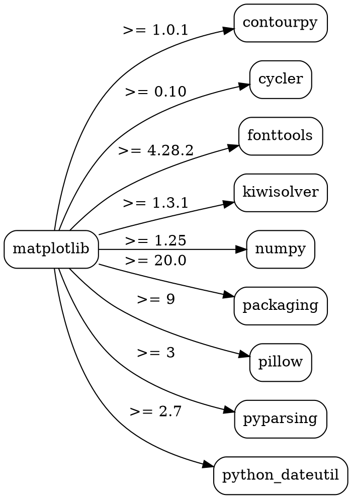
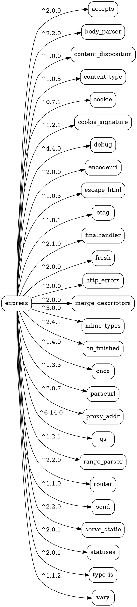

# Практическое занятие № 2. Менеджеры пакетов

## Цель работы

Изучить метаданные пакетов из разных экосистем, определить их прямые зависимости и построить графы зависимостей с помощью Graphviz.

---

## Задание 1. Анализ метаданных пакета Matplotlib

### 1.1. Получение исходного кода пакета

Для исследования выбран пакет **Matplotlib** версии **3.11.2**.

Архив исходного кода был загружен напрямую из репозитория PyPI, без установки пакета через `pip`:

```bash
curl -L "https://files.pythonhosted.org/packages/e7/c8/9aa712a0afb882649424dd8de8ad9aa6235e796e84c6052e8f6dc1598d0d/matplotlib-3.11.2.tar.gz" -o matplotlib-3.11.2.tar.gz
```

Проверка архива:

```bash
ls -lh matplotlib-3.11.2.tar.gz
tar -tzf matplotlib-3.11.2.tar.gz | head -n 15
```

Архив успешно скачан. Его размер составил около 32 МБ. Содержимое архива было просмотрено, после чего архив распакован:

```bash
tar -xzf matplotlib-3.11.2.tar.gz
cd matplotlib-3.11.2
```

В корневой директории обнаружены файлы `PKG-INFO` и `pyproject.toml`.

### 1.2. Изучение метаданных

Для просмотра метаданных использовались команды:

```bash
sed -n '1,100p' PKG-INFO
sed -n '1,180p' pyproject.toml
```

В файле `PKG-INFO` найдены следующие поля:

| Поле | Значение | Назначение |
|---|---|---|
| `Metadata-Version` | `2.1` | Версия формата метаданных |
| `Name` | `matplotlib` | Название пакета |
| `Version` | `3.11.2` | Версия пакета |
| `Summary` | `Python plotting package` | Краткое описание |
| `Author` | `John D. Hunter, Michael Droettboom` | Авторы |
| `Author-Email` | `Unknown <matplotlib-users@python.org>` | Контактный адрес |
| `License` | License agreement for matplotlib | Информация о лицензии |

Файл `pyproject.toml` содержит основные сведения о проекте, требования к Python, ссылки на ресурсы проекта, параметры сборки и списки зависимостей.

Минимальная требуемая версия Python:

```toml
requires-python = ">=3.11"
```

### 1.3. Прямые зависимости Matplotlib

В разделе `dependencies` файла `pyproject.toml` указаны следующие прямые зависимости:

| № | Зависимость | Минимальная версия |
|---:|---|---:|
| 1 | `contourpy` | `1.0.1` |
| 2 | `cycler` | `0.10` |
| 3 | `fonttools` | `4.28.2` |
| 4 | `kiwisolver` | `1.3.1` |
| 5 | `numpy` | `1.25` |
| 6 | `packaging` | `20.0` |
| 7 | `pillow` | `9` |
| 8 | `pyparsing` | `3` |
| 9 | `python-dateutil` | `2.7` |

Список был дополнительно проверен по полям `Requires-Dist` файла `PKG-INFO`:

```bash
grep -E '^(Requires-Python|Requires-Dist|Provides-Extra):' PKG-INFO
```

Полученные зависимости совпали со списком из `pyproject.toml`.

### 1.4. Вывод по заданию 1

Были изучены метаданные Matplotlib версии 3.11.2. Определены основные сведения о пакете, минимальная версия Python и девять прямых зависимостей. Исходный архив был получен напрямую из PyPI без установки пакета через пакетный менеджер.

---

## Задание 2. Анализ метаданных пакета Express

### 2.1. Получение исходного кода пакета

Для исследования выбран пакет **Express** версии **5.1.0**.

Архив исходного кода был загружен напрямую из npm Registry, без установки пакета через `npm`:

```bash
curl -L https://registry.npmjs.org/express/-/express-5.1.0.tgz -o express-5.1.0.tgz
```

Проверка архива:

```bash
ls -lh express-5.1.0.tgz
tar -tzf express-5.1.0.tgz | head -n 15
```

Архив успешно скачан. Его размер составил около 51 КБ. После проверки архив был распакован:

```bash
tar -xzf express-5.1.0.tgz
ls package
```

В распакованном каталоге найден файл `package.json`, содержащий метаданные пакета.

### 2.2. Изучение метаданных

Файл был просмотрен командой:

```bash
cat package/package.json
```

Основные сведения о пакете:

| Поле | Значение |
|---|---|
| `name` | `express` |
| `version` | `5.1.0` |
| `description` | `Fast, unopinionated, minimalist web framework` |
| `author` | `TJ Holowaychuk <tj@vision-media.ca>` |
| `license` | `MIT` |
| `repository` | `expressjs/express` |
| `homepage` | `https://expressjs.com/` |
| `engines.node` | `>= 18` |

Таким образом, для работы с Express требуется Node.js версии 18 или выше.

### 2.3. Прямые зависимости Express

В файле `package.json` зависимости основного пакета перечислены в разделе `dependencies`. Для просмотра использовалась команда:

```bash
grep -A 15 '"dependencies"' package/package.json
```

Обнаружены 27 прямых зависимостей:

| № | Зависимость | Диапазон версии |
|---:|---|---|
| 1 | `accepts` | `^2.0.0` |
| 2 | `body-parser` | `^2.2.0` |
| 3 | `content-disposition` | `^1.0.0` |
| 4 | `content-type` | `^1.0.5` |
| 5 | `cookie` | `^0.7.1` |
| 6 | `cookie-signature` | `^1.2.1` |
| 7 | `debug` | `^4.4.0` |
| 8 | `encodeurl` | `^2.0.0` |
| 9 | `escape-html` | `^1.0.3` |
| 10 | `etag` | `^1.8.1` |
| 11 | `finalhandler` | `^2.1.0` |
| 12 | `fresh` | `^2.0.0` |
| 13 | `http-errors` | `^2.0.0` |
| 14 | `merge-descriptors` | `^2.0.0` |
| 15 | `mime-types` | `^3.0.0` |
| 16 | `on-finished` | `^2.4.1` |
| 17 | `once` | `^1.4.0` |
| 18 | `parseurl` | `^1.3.3` |
| 19 | `proxy-addr` | `^2.0.7` |
| 20 | `qs` | `^6.14.0` |
| 21 | `range-parser` | `^1.2.1` |
| 22 | `router` | `^2.2.0` |
| 23 | `send` | `^1.1.0` |
| 24 | `serve-static` | `^2.2.0` |
| 25 | `statuses` | `^2.0.1` |
| 26 | `type-is` | `^2.0.1` |
| 27 | `vary` | `^1.1.2` |

В `package.json` также присутствует раздел `devDependencies`. Он содержит инструменты и пакеты, используемые при разработке и тестировании. Они не включались в граф прямых зависимостей Express, поскольку граф строился по разделу `dependencies`.

### 2.4. Вывод по заданию 2

Были изучены метаданные Express версии 5.1.0. Определены автор, лицензия, репозиторий, требование к версии Node.js и 27 прямых зависимостей. Исходный архив был получен непосредственно из npm Registry без установки пакета через `npm`.

---

## Задание 3. Построение графов зависимостей

Для визуализации использовалась программа **Graphviz**. В среде Ubuntu/WSL была проверена доступность команды `dot`:

```bash
dot -V
```

Использовалась версия Graphviz `2.43.0`.

### 3.1. Граф зависимостей Matplotlib

Для построения графа был создан файл `matplotlib.dot`:



Изображение было создано командой:

```bash
dot -Tpng matplotlib.dot -o matplotlib.png
```

Результат:


На графе показан пакет Matplotlib и девять его прямых зависимостей. Подписи на рёбрах показывают минимальные версии зависимостей.

### 3.2. Граф зависимостей Express

Для построения графа был создан файл `express.dot`:



Изображение было создано командой:

```bash
dot -Tpng express.dot -o express.png
```

Результат:


На графе показан пакет Express и 27 его прямых зависимостей. Подписи на рёбрах показывают диапазоны версий, указанные в `package.json`.

### 3.3. Сравнение графов

| Характеристика | Matplotlib | Express |
|---|---:|---:|
| Версия | 3.11.2 | 5.1.0 |
| Экосистема | Python | JavaScript / Node.js |
| Файл метаданных | `PKG-INFO`, `pyproject.toml` | `package.json` |
| Количество прямых зависимостей | 9 | 27 |
| Файл графа DOT | `matplotlib.dot` | `express.dot` |
| Изображение графа | `matplotlib.png` | `express.png` |

Matplotlib имеет 9 прямых зависимостей, а Express — 27. Следовательно, в исследованных версиях Express непосредственно зависит от большего количества пакетов.

### 3.4. Вывод по заданию 3

Для двух пакетов из разных экосистем были построены графы прямых зависимостей с помощью Graphviz. Описания графов сохранены в формате DOT, а изображения — в формате PNG. На графах отображены прямые зависимости и ограничения версий, указанные в метаданных пакетов.

---

## Общий вывод по выполненным заданиям 1–3

В ходе работы были исследованы два пакета: Matplotlib из экосистемы Python и Express из экосистемы JavaScript/Node.js. Исходные архивы были получены непосредственно из соответствующих репозиториев пакетов без установки через пакетные менеджеры.

Были изучены форматы метаданных `PKG-INFO`, `pyproject.toml` и `package.json`, определены основные сведения о пакетах, требования к среде выполнения и прямые зависимости.

С помощью Graphviz построены графы прямых зависимостей Matplotlib и Express. Полученные графы позволяют наглядно сравнить структуру зависимостей двух пакетов.

---

## Задания 4–7

Задания 4–7 в этом документе пока не выполнены. Их решения и результаты будут добавлены после выполнения соответствующих практических частей.
